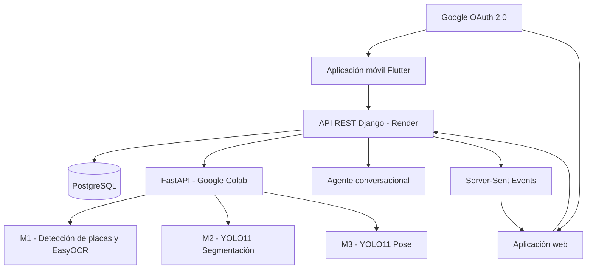

# Sistema Inteligente de Control de Peaje

## 1. Información del proyecto

- **Estudiante:** Adriana Ayllón Pardo.
- **Universidad:** Universidad Privada Franz Tamayo – UNIFRANZ.
- **Carrera:** Ingeniería de Sistemas.
- **Asignatura:** IAM-811 Machine Learning y Aprendizaje Profundo.
- **Gestión:** II-2026.
- **Modalidad:** Individual.
- **Rol:** Desarrollo, entrenamiento, integración, despliegue y documentación.

## 2. Descripción

Sistema inteligente de control de peaje basado en visión por computadora y aprendizaje profundo, capaz de detectar placas vehiculares, clasificar vehículos y estimar el número de ejes para determinar la tarifa correspondiente.

El sistema integra una aplicación móvil, una plataforma web en tiempo real, una API REST, una base de datos PostgreSQL y un agente conversacional para consultar información vehicular por texto o imagen.

## 3. Objetivos

- Automatizar la identificación de vehículos mediante inteligencia artificial.
- Detectar y reconocer placas mediante OCR.
- Clasificar vehículos mediante segmentación de instancias.
- Estimar el número de ejes mediante keypoints.
- Gestionar tarifas, saldos, registros y alertas.
- Visualizar los registros vehiculares en tiempo real.
- Garantizar el acceso mediante autenticación de Google.

## 4. Arquitectura



## 5. Tecnologías utilizadas

| Componente | Tecnología |
|---|---|
| Aplicación móvil | Flutter y Dart |
| Backend | Django REST Framework |
| Frontend web | HTML, CSS, Bootstrap y JavaScript |
| Base de datos | PostgreSQL |
| Autenticación | Google OAuth 2.0 y JWT |
| Tiempo real | Server-Sent Events |
| Detección de placas | YOLOv9 y ONNX Runtime |
| Reconocimiento de placas | EasyOCR |
| Segmentación | YOLO11n-seg |
| Keypoints | YOLO11n-pose |
| API de inferencia | FastAPI |
| Entrenamiento | Google Colab |
| Gestión de datasets | Roboflow |
| Hosting web | Render |
| Publicación de inferencia | ngrok desde Google Colab |
| Documentación API | Swagger / OpenAPI |
| Control de versiones | Git y GitHub |

## 6. Modelos de inteligencia artificial

### M1. Detección y reconocimiento de placas

Utiliza un modelo YOLOv9 en formato ONNX para localizar placas vehiculares. Posteriormente, EasyOCR reconoce los caracteres y normaliza el resultado.

### M2. Segmentación de vehículos

Modelo YOLO11n-seg entrenado durante 15 épocas para identificar cinco categorías:

- Auto.
- Bus.
- Camión.
- Minibús.
- Moto.

Resultados de validación:

| Métrica | Resultado |
|---|---:|
| Precisión de segmentación | 91.7 % |
| Recall de segmentación | 88.8 % |
| mAP50 de segmentación | 93.4 % |
| mAP50-95 de segmentación | 84.4 % |
| Imágenes de entrenamiento | 2015 |
| Imágenes de validación | 572 |

### M3. Detección de keypoints

Modelo YOLO11n-pose entrenado para identificar puntos clave de las ruedas y estimar el número de ejes del vehículo.

El entrenamiento utiliza cinco puntos clave por rueda. La estimación del número de ejes se realiza mediante la detección y agrupación de ruedas visibles.

## 7. Funcionalidades

### Aplicación web

- Inicio de sesión con Google.
- Panel de control vehicular.
- Gestión de vehículos, casetas y tarifas.
- Historial de pasos.
- Registro de alertas.
- Control de saldos.
- Agente conversacional.
- Estado del servicio de inferencia.
- Actualización automática mediante SSE.

### Aplicación móvil

- Inicio de sesión con Google.
- Selección de caseta.
- Captura continua mediante cámara.
- Procesamiento de imágenes vehiculares.
- Visualización de placa, categoría, ejes, tarifa y estado.
- Consulta de placas por texto e imagen.

### Agente conversacional

Consulta información almacenada en la base de datos y permite identificar los siguientes estados:

1. Vehículo registrado con historial de pasos.
2. Vehículo registrado sin historial de pasos.
3. Vehículo identificado, pero no registrado.
4. Placa inexistente en el sistema.

## 8. Estructura del repositorio

```text
peaje-inteligente/
├── entrenamiento/
│   ├── M2_Entrenamiento_Segmentacion_Vehiculos.ipynb
│   └── M3_Entrenamiento_Keypoints_Llantas.ipynb
├── inferencia/
│   └── API_Inferencia_Peaje_CORREGIDO.ipynb
├── web/
├── movil/
├── docs/
├── .env.example
├── .gitignore
└── README.md
```

## 9. API REST

| Método | Endpoint |
|---|---|
| POST | /api/v1/auth/google |
| POST | /api/v1/pasos/frame |
| POST | /api/v1/placas/consultar |
| POST | /api/v1/placas/consultar-imagen |
| GET | /api/v1/placas/{placa}/historial |
| GET | /api/v1/casetas/{id}/resumen |
| POST | /api/v1/agente/chat |
| GET | /api/v1/inferencia/estado |

Las rutas protegidas requieren autenticación mediante JWT o sesión autorizada.

## 10. Instalación del backend

```bash
git clone https://github.com/gatadri/peaje-inteligente.git
cd peaje-inteligente/web

python -m venv venv
```

Activación del entorno virtual en Windows:

```powershell
.\venv\Scripts\Activate.ps1
```

Instalación y configuración:

```bash
pip install -r requirements.txt
python manage.py migrate
python manage.py shell -c "import runpy; runpy.run_path('datos_iniciales.py')"
python manage.py runserver
```

Se debe configurar previamente el archivo `.env` dentro de la carpeta `web`, utilizando como referencia `.env.example`.

## 11. Instalación de la aplicación móvil

```bash
cd movil
flutter pub get
flutter analyze
flutter build apk --debug
```

El APK generado se encuentra en:

```text
build/app/outputs/flutter-apk/app-debug.apk
```

Para utilizar Google Sign-In se requiere configurar un cliente OAuth Android con el nombre del paquete y la huella SHA-1 correspondiente, además del identificador del cliente OAuth web.

## 12. Despliegue de la inferencia

1. Abrir el notebook de inferencia en Google Colab.
2. Conectar Google Drive.
3. Cargar los modelos M1, M2 y M3.
4. Iniciar el servidor FastAPI.
5. Publicar el endpoint mediante ngrok.
6. Configurar las variables INFERENCE_URL e INFERENCE_TOKEN en Render.
7. Verificar el estado del servicio.

La sesión de Colab debe permanecer activa para que el servicio de inferencia esté disponible.

## 13. Despliegue web

La aplicación Django se encuentra desplegada en Render y utiliza una base de datos PostgreSQL alojada en la nube.

Comando de construcción:

```bash
bash build.sh
```

Servidor de producción:

```bash
gunicorn config.wsgi:application --bind 0.0.0.0:$PORT --workers 1 --threads 8 --timeout 180
```

## 14. Enlaces del proyecto

- Repositorio: https://github.com/gatadri/peaje-inteligente
- Aplicación web: https://peaje-inteligente-xkd1.onrender.com
- Dataset de segmentación: https://universe.roboflow.com/adriana-ayllon/vehicle-classification-v2-dopil
- Proyecto de etiquetado de ruedas: https://universe.roboflow.com/adriana-ayllon/peaje-llantas-m3-yntnd
- Endpoint de inferencia: dirección HTTPS temporal generada mediante ngrok durante la ejecución de Colab.

## 15. Seguridad

- Autenticación mediante Google OAuth 2.0.
- Lista blanca de usuarios autorizados.
- Roles de administrador y operador.
- Protección de endpoints mediante JWT.
- Comunicación mediante HTTPS.
- Variables de entorno para credenciales.
- Validación de imágenes y solicitudes.

Las contraseñas, tokens y claves privadas no deben almacenarse en el repositorio.

## 16. Limitaciones

La disponibilidad de la inferencia depende de la sesión activa de Google Colab. La precisión del OCR y la estimación de ejes pueden verse afectadas por la iluminación, la perspectiva y la calidad de las imágenes.

El modelo M3 utiliza etiquetas generadas automáticamente, por lo que requiere validación adicional. La velocidad de captura móvil depende del tiempo de respuesta del servicio de inferencia.

## 17. Autoría

Proyecto académico desarrollado individualmente para la asignatura Machine Learning y Aprendizaje Profundo de la Universidad Privada Franz Tamayo, gestión II-2026.